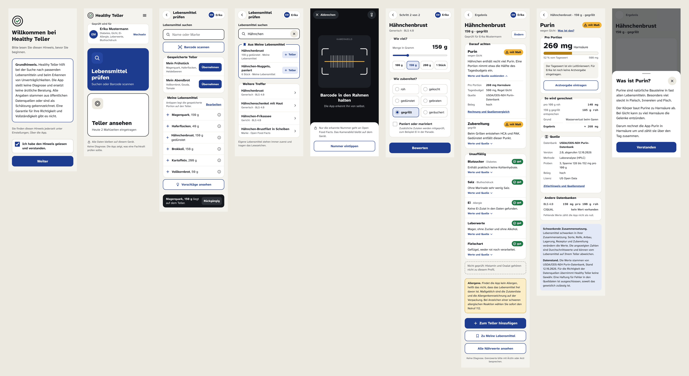

# Healthy Teller

**Passt dieses Lebensmittel zu mir, obwohl ich Diabetes, Gicht und eine Ei-Allergie gleichzeitig habe?**

Healthy Teller ist eine freie App, die jedes Lebensmittel gleichzeitig gegen alle Erkrankungen, Unverträglichkeiten und Ziele einer Person prüft. Zu jeder Bewertung zeigt sie den Wert pro Portion, einen Satz Begründung und die Quelle.

> Healthy Teller is a free, open-source app that checks food against several medical conditions, allergies and goals at once, and explains every verdict with value, reason and source. The app is German-first; this README and the project docs are in German.



## Wofür?

Nährwert-Apps zählen Kalorien und Makros. Wer aber mehrere Ernährungsauflagen gleichzeitig hat, zum Beispiel Diabetes und Gicht oder Niere und Bluthochdruck, muss Zucker, Purin, Salz, Kalium und Allergene bisher von Hand gegeneinander abwägen. Genau dabei hilft Healthy Teller:

- **Alle Auflagen auf einmal.** Ein Lebensmittel wird gegen jede Erkrankung und Allergie des Profils geprüft, jede für sich.
- **Keine Gesamtnote.** Ein guter Ballaststoffwert überdeckt nie eine Allergenwarnung.
- **Jede Aussage belegt.** Wert, Grund, Quelle und Datenvollständigkeit stehen bei jeder Ampel.
- **Ehrlich bei Lücken.** Fehlt ein Wert, steht dort „unbekannt“, nie 0. Die App sagt nie „sicher“ oder „frei von“.
- **Für Angehörige.** Mehrere Profile, zum Beispiel das eigene und das der Mutter, und eine Druckliste für den Kühlschrank oder die Arztpraxis.

## Was Healthy Teller nicht ist

Die App stellt keine Diagnose, berechnet keine Medikamenten- oder Insulindosis und ersetzt keine ärztliche Beratung oder Ernährungstherapie. Sie macht sichtbar, was eine Fachkraft prüfen sollte, und liefert die Belege dazu.

## Privatsphäre

- Kein Konto, kein eigener Server, keine Werbung, kein Tracking.
- Profile, Diagnosen und Arztvorgaben bleiben auf dem Gerät.
- Netzverkehr gibt es nur zu den Originalquellen der Daten, zum Beispiel die Barcode-Nummer an Open Food Facts.

## Stand

Erste nutzbare Version:

- Profil mit Erkrankungen, Allergien und Arztvorgaben
- Produkte per Barcode-Nummer oder Name aus [Open Food Facts](https://world.openfoodfacts.org)
- Bewertung von Allergenen und eigenen Arztvorgaben, Teller mit Tagessummen, Meine Lebensmittel, Druckliste
- Gerätewechsel über eine verschlüsselte Exportdatei
- Web, Desktop (Linux, Windows, macOS) und Android aus einer Codebasis

Fachlich geprüfte Regeln und Referenzwerte fehlen noch. Für Erkrankungen zeigt die App deshalb meist „unbekannt“. Jede Grenze braucht eine zitierte Quelle und eine fachliche Freigabe. Hier hilft das Projekt am meisten Unterstützung, siehe [Mitmachen](#mitmachen).

## Ausprobieren

Die Web-Version läuft ohne Installation im Browser, auch auf dem iPhone: **https://piminusmax.github.io/healthyteller/** (nach jedem Merge auf `main` aktualisiert). Über „Zum Home-Bildschirm“ lässt sie sich wie eine App ablegen.

Selbst bauen geht am einfachsten im Dev Container (`.devcontainer/`, zum Beispiel mit VS Code), der alle Werkzeuge mitbringt. Ohne Container braucht es:

- Rust (stable) und das Ziel `wasm32-unknown-unknown`
- [dx 0.7.10](https://github.com/DioxusLabs/dioxus/releases/tag/v0.7.10), das Werkzeug von Dioxus
- unter Linux für die Desktop-App: `libwebkit2gtk-4.1-dev libgtk-3-dev libxdo-dev`
- für Android: Android SDK und NDK

```sh
cd crates/app
dx serve --platform web        # im Browser, http://127.0.0.1:8080
dx serve --platform desktop    # als Desktop-App
dx serve --platform android    # im Emulator oder auf einem Gerät per USB
```

## Mitmachen

Beiträge sind willkommen, auch ohne Programmierkenntnisse:

- **Fachwissen:** Ernährungsfachkräfte, Ärztinnen und Ärzte können Regeln und Grenzwerte mit Quelle vorschlagen und prüfen.
- **Testen:** Die App mit echten Produkten ausprobieren und Fehler melden.
- **Code:** Rust, Dioxus und Playwright-Tests.

Wie das geht und welche Regeln dabei gelten, steht in [CONTRIBUTING.md](CONTRIBUTING.md).

## Aufbau

| Ordner | Inhalt |
| --- | --- |
| `crates/core` | Datenmodell, Regel-Engine, Bewertung; ohne Oberfläche, Netz und Dateisystem |
| `crates/ingest` | Import-Adapter je Datenquelle, Regelwerk laden |
| `crates/storage` | lokaler Speicher |
| `crates/barcode` | Barcode-Erkennung (in Arbeit) |
| `crates/app` | Dioxus-Oberfläche für Web, Desktop, Android, iOS |
| `locales/` | Oberflächentexte, Deutsch zuerst |
| `rules/`, `mappings/`, `estimates/`, `references/`, `sources/` | Regelwerk und Begleitdaten, nur IDs und Quellenangaben |
| `fixtures/` | Testdateien mit erfundenen Werten |
| `e2e/` | Ende-zu-Ende- und Barrierefreiheitstests |
| `docs/` | [Konzept](docs/konzept.md), [Mockups](docs/mockups/README.md), [Architekturentscheidungen](docs/adr/) |

## Lizenz

- Code: [GPL-3.0-or-later](LICENSE)
- Regelwerk, Zuordnungstabellen und Texte: [CC BY-SA 4.0](LICENSES/CC-BY-SA-4.0.txt)
- Schrift Atkinson Hyperlegible: SIL Open Font License 1.1
- Fremddaten (Open Food Facts, BLS, USDA usw.) liegen nicht im Repo. Jede Installation lädt sie selbst von der Quelle; es gelten deren Bedingungen. Produktdaten von Open Food Facts stehen unter der Open Database License.
