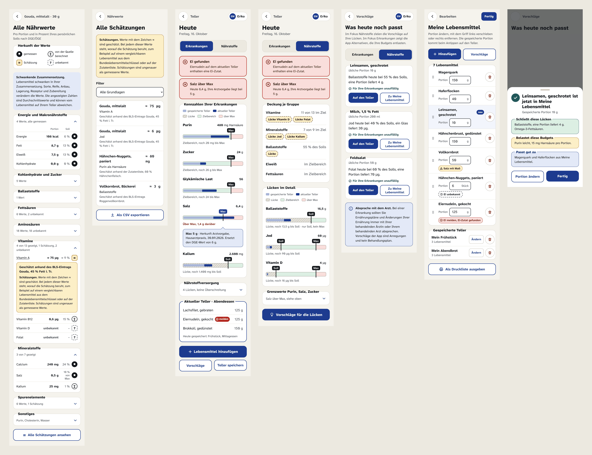
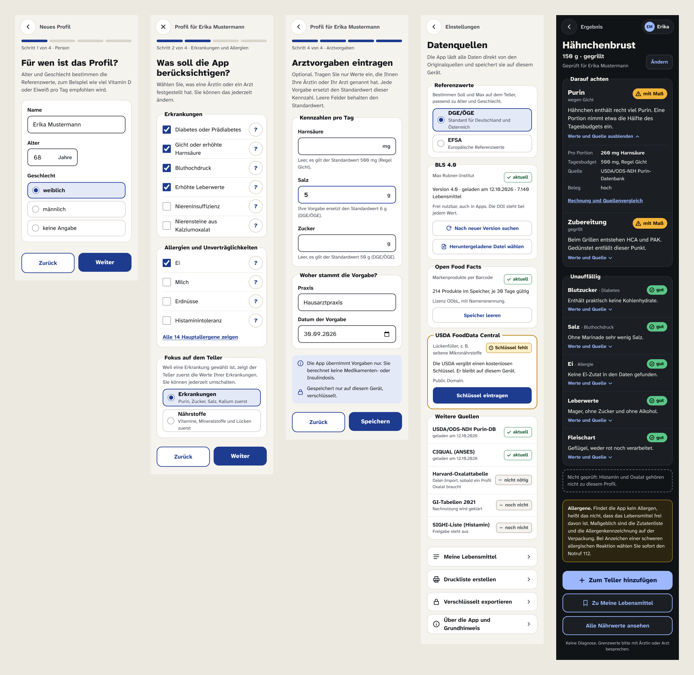
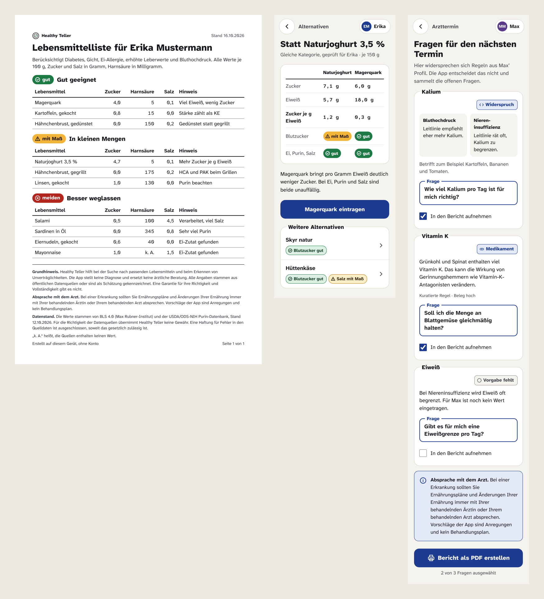

# Mockups

Oberflächen-Mockups für Healthy Teller. Sie dienen als Referenz für Aufbau, Texte und Verhalten der Dioxus-Oberfläche in `crates/app`.

## Wichtig

- **Alle Zahlen sind erfunden.** Nährwerte, Grenzwerte, Versionen und Abrufdaten in den Mockups sind Beispielwerte ohne Quellenprüfung. Sie gehören nie in Code, Regeln, Fixtures mit Erwartungswerten oder Tests (Projektregel 2).
- **Alle Profile sind erfunden.** Erika und Max Mustermann sind Testpersonen ohne Bezug zu echten Menschen (Projektregel 18).
- **Hinweistexte sind verbindlich.** Die sechs Hinweise unten stehen im festen Wortlaut und sind nicht abschaltbar.
- **Kein Code zum Kopieren.** Das HTML zeigt das Ziel. Umgesetzt wird mit Dioxus und Übersetzungsdateien, Deutsch zuerst, Anrede „Sie“ (Projektregel 16).

## Ansehen

`index.html` im Browser öffnen. Jedes Bild führt zum klickbaren Screen, die Screens sind untereinander verlinkt. Es gibt kein JavaScript und keine Netzabfrage, die Schrift liegt lokal in `assets/fonts/`. Auf- und Zuklappen funktioniert über `details` und `summary`.

## Screens

| Nr | Screen | Was er zeigt |
|----|--------|--------------|
| 01 | [Grundhinweis](png/01-grundhinweis.png) | Erster Start mit Bestätigung des Grundhinweises |
| 02 | [Start](png/02-start.png) | Zwei Hauptaktionen, Lebensmittel prüfen und Teller ansehen |
| 03 | [Suche mit Meine Lebensmittel](png/03-suche-meine-lebensmittel.png) | Leeres Suchfeld, gespeicherte Teller zum Übernehmen, Meine Lebensmittel mit Portion, Antippen legt auf den Teller |
| 04 | [Suche beim Tippen](png/04-suche-tippen.png) | Eigene Lebensmittel als erste Treffer, mit Lesezeichen markiert |
| 05 | [Barcode-Scan](png/05-barcode-scan.png) | Scan, nur die Nummer verlässt das Gerät |
| 06 | [Portion und Zubereitung](png/06-portion-zubereitung.png) | Menge, Garmethode, Panade |
| 07 | [Lebensmittelkarte](png/07-lebensmittelkarte.png) | Erste Ansicht nur Urteil und Grund, Werte und Quelle nach Antippen, Allergen-Hinweis |
| 08 | [Detail und Quelle](png/08-detail-quelle.png) | Rechnung, Quelle, Quellenvergleich, Hinweise zu Zusammensetzung und Datenstand |
| 09 | [Fachbegriff](png/09-fachbegriff.png) | Erklärung in einfacher Sprache |
| 10 | [Vollständige Nährwertliste](png/10-naehrwertliste.png) | Gruppen einklappbar, Wert pro Portion, Prozent vom Soll, Herkunftskennzeichen |
| 11 | [Alle Schätzungen](png/11-alle-schaetzungen.png) | Liste mit Filter und CSV-Export |
| 12 | [Teller, Fokus Erkrankungen](png/12-teller-fokus-erkrankungen.png) | Balken mit Soll und Max, drei Zonen, Herkunft einer Marke, Nährstoffe eingeklappt |
| 13 | [Teller, Fokus Nährstoffe](png/13-teller-fokus-naehrstoffe.png) | Deckung je Gruppe, Lücken hervorgehoben, Grenzwerte eingeklappt |
| 14 | [Vorschläge](png/14-vorschlaege.png) | Karten mit Portion und einem Satz Begründung, Hinweis zur Absprache mit dem Arzt |
| 15 | [Meine Lebensmittel bearbeiten](png/15-meine-lebensmittel-bearbeiten.png) | Hinzufügen, Portion ändern, verschieben, entfernen, gespeicherte Teller |
| 16 | [Rückmeldung beim Hinzufügen](png/16-rueckmeldung-hinzufuegen.png) | Schließt Lücken, belastet Budgets, passt gut zu |
| 17 | [Profil, Person](png/17-profil-person.png) | Name, Alter, Geschlecht für die Referenzwerte |
| 18 | [Profil, Erkrankungen und Fokus](png/18-profil-erkrankungen-fokus.png) | Erkrankungen, Allergien, Fokus mit erklärendem Satz |
| 19 | [Arztvorgaben](png/19-arztvorgaben.png) | Vorgabe je Kennzahl ersetzt den Standardwert |
| 20 | [Einstellungen und Datenquellen](png/20-einstellungen-datenquellen.png) | Referenzwerte DGE/ÖGE oder EFSA, Stand je Quelle, Über die App |
| 21 | [Lebensmittelkarte dunkel](png/21-lebensmittelkarte-dunkel.png) | Dunkelmodus |
| 22 | [Druckliste A4](png/22-druckliste-a4.png) | Positiv- und Meideliste mit Grundhinweis, Arzthinweis und Datenstand |
| 23 | [Alternativen](png/23-alternativen.png) | Vergleich zweier Lebensmittel (Ausbau) |
| 24 | [Fragen an den Arzt](png/24-arztfragen.png) | Konfliktbericht mit Arzthinweis (Ausbau) |

Die Nährwertliste zeigt einen Gouda statt der Hähnchenbrust, weil dort Schätzungen und unbekannte Werte vorkommen.

## Gestaltungsregeln

- Ampeln zeigen immer Form, Symbol und Wort. **gut** ist ein Kreis mit Haken, **mit Maß** ein Dreieck, **meiden** ein Achteck mit Kreuz, **unbekannt** ein gestrichelter Rahmen mit Fragezeichen.
- Die erste Ansicht einer Lebensmittelkarte zeigt nur Urteil und Grund. Werte und Quellen klappen erst nach Antippen auf.
- Es gibt keine Gesamtnote. Jede Dimension steht für sich.
- Teller-Balken zeigen den Tagesstand mit beschrifteten Marken „Soll“ und „Max“. Ballaststoffe haben nur Soll, Purin, Salz und Zucker nur Max, Jod und Vitamin D beides. Drei Zonen: Lücke (schraffiert), Zielbereich, über Max. Gespeicherte Teller sind blass, der aktuelle Teller kräftig. Eine angetippte Marke zeigt ihre Herkunft (DGE/ÖGE, EFSA, Regel oder Arztvorgabe).
- Der Fokus richtet sich nach dem Profil. Mit Erkrankung steht er auf „Erkrankungen“, sonst auf „Nährstoffe“. Ein gefundenes Allergen und jeder überschrittene Höchstwert stehen unabhängig vom Fokus immer ganz oben und sind nie eingeklappt.
- Herkunftskennzeichen in der Nährwertliste: ● gemessen, ∑ von der Quelle berechnet, ≈ Schätzung, ? unbekannt. Unbekannt ist nie 0.
- Überschriften von Karten sitzen immer auf der oberen Kante, wie bei einem Formular-Rahmen. So ist klar, was zur Karte gehört.
- Kein Screen berechnet eine Dosis. Arztvorgaben werden nur übernommen.
- Grundschrift 18 px, Touch-Flächen mindestens 44 px, Kontrast mindestens 4,5:1 in Hell und Dunkel.

## Hinweise im festen Wortlaut

| Hinweis | Wo er erscheint | Screens |
|---------|-----------------|---------|
| Grundhinweis | erster Start mit Bestätigung, dauerhaft unter „Über die App“, jede Druckliste | 01, 20, 22 |
| Absprache mit dem Arzt | Vorschläge, Druckliste, Konfliktbericht bei aktivem Krankheitsprofil | 14, 22, 24 |
| Schwankende Zusammensetzung | Nährwertliste, Quellenansicht | 08, 10 |
| Schätzungen | an jedem geschätzten Wert, über der Schätzliste | 10, 11 |
| Allergene | jede Lebensmittelkarte, wenn das Profil eine Allergie enthält | 07, 21 |
| Datenstand | Quellenansicht, Druckliste | 08, 22 |

**Grundhinweis.** Healthy Teller hilft bei der Suche nach passenden Lebensmitteln und beim Erkennen von Unverträglichkeiten. Die App stellt keine Diagnose und ersetzt keine ärztliche Beratung. Alle Angaben stammen aus öffentlichen Datenquellen oder sind als Schätzung gekennzeichnet. Eine Garantie für ihre Richtigkeit und Vollständigkeit gibt es nicht.

**Absprache mit dem Arzt.** Bei einer Erkrankung sollten Sie Ernährungspläne und Änderungen Ihrer Ernährung immer mit Ihrer behandelnden Ärztin oder Ihrem behandelnden Arzt absprechen. Vorschläge der App sind Anregungen und kein Behandlungsplan.

**Schwankende Zusammensetzung.** Lebensmittel schwanken in ihrer Zusammensetzung. Sorte, Reife, Anbau, Lagerung, Rezeptur und Zubereitung verändern die Werte. Die angezeigten Zahlen sind Durchschnittswerte und können vom Lebensmittel auf Ihrem Teller abweichen.

**Schätzungen.** Werte mit dem Zeichen ≈ sind geschätzt. Bei jedem dieser Werte steht, worauf die Schätzung beruht, zum Beispiel auf einem vergleichbaren Lebensmittel aus dem Bundeslebensmittelschlüssel oder auf der Zutatenliste. Schätzungen sind ungenauer als gemessene Werte.

**Allergene.** Findet die App kein Allergen, heißt das nicht, dass das Lebensmittel frei davon ist. Maßgeblich sind die Zutatenliste und die Allergenkennzeichnung auf der Verpackung. Bei Anzeichen einer schweren allergischen Reaktion wählen Sie sofort den Notruf 112.

**Datenstand.** Die Werte stammen von {Quelle}, Stand {Datum}. Für die Richtigkeit der Datenquellen übernimmt Healthy Teller keine Gewähr. Eine Haftung für Fehler in den Quelldaten ist ausgeschlossen, soweit das gesetzlich zulässig ist.

## Design-Tokens

`assets/design-tokens.css` enthält Farben, Schrift, Radien und Touch-Maße als CSS-Variablen für Hell und Dunkel. Schrift ist Atkinson Hyperlegible Next, entwickelt vom Braille Institute für Menschen mit Sehschwäche, Zahlen in Tabellen nutzen Atkinson Hyperlegible Mono. Beide stehen unter der SIL Open Font License 1.1 (`assets/fonts/OFL.txt`).

## Barrierefreiheit

Die statischen Screens in `screens/` wurden mit axe-core 4.10 gegen WCAG 2.2 AA und Best Practices geprüft, ohne Verstöße.

## Ordner

| Pfad | Inhalt |
|------|--------|
| `index.html` | Übersicht mit allen Screens |
| `screens/` | Statische HTML-Fassung je Screen, ohne JavaScript |
| `png/` | Screenshots in doppelter Auflösung |
| `overview-*.png` | Übersichtsbilder je Gruppe |
| `assets/` | Schrift, `fonts.css`, `design-tokens.css` |
| `canvas-source/` | Originaldateien des Design-Canvas (`.dc.html`, `canvas.json`) |
